

  <h1 style="margin-bottom: 20px; color: #00723F;">UNIVERSIDAD AUTÓNOMA DE BAJA CALIFORNIA</h1>
  
  
  
  <h2 style="margin-bottom: 40px; color: #333;">FACULTAD DE CIENCIAS QUÍMICAS DE INGENIERÍA</h2>
  <h2 style="margin-bottom: 40px; color: #333;">Ingeniería en Software y Tecnologías Emergentes</h2>
  

	  
<strong>Profesor:</strong> Mauricio Alonso Sanchez Herrera

      
<strong>Materia:</strong> Ciencia de datos 

      
<strong>Grupo:</strong> 371 

      
<strong>Alumno:</strong> Jorge Alberto Rueda Gallegos

      
<strong>Matrícula:</strong> 2201442

      
<strong>Correo:</strong> rueda.jorge@uabc.edu.mx

      
<strong>Fecha de realización:</strong> Lunes 12 de Octubre

  

   

## Instrucciones

- Conseguir 1 dataset de agrupación + 1 dataset de clasificación (dataset del Iris)
- Usar 4 técnicas diferentes para agrupar (partición, densidad, jerárquico y cuadrícula: CLIQUE)
- Utilizar mínimo 3 técnicas intrínsecas y 1 extrínseca, dependiendo del caso, para determinar la calidad de los grupos
- Para el caso del dataset de clasificación, para usarlo como dataset de agrupación hay eliminar las etiquetas pero usarlas como el ground truth (extrínsecas)

## Datasets

### Iris

El archivo tiene 150 registros, cuatro variables numéricas y tres especies. Hay
50 registros de cada especie y no hay datos faltantes.

| especie | cantidad |
|---|---:|
| setosa | 50 |
| versicolor | 50 |
| virginica | 50 |
promedios meramente demostrativos

| especie | sepal_length | sepal_width | petal_length | petal_width |
|---|---:|---:|---:|---:|
| setosa | 5.006 | 3.418 | 1.464 | 0.244 |
| versicolor | 5.936 | 2.770 | 4.260 | 1.326 |
| virginica | 6.588 | 2.974 | 5.552 | 2.026 |

### IMDb

El archivo contiene 1,000 películas y 16 columnas. Para la agrupación se
utilizaron cinco variables numéricas; `Released_Year` se dejó fuera para que el
año de estreno no influyera en los métodos. `Runtime` se convirtió a minutos;
`No_of_Votes` y `Gross` se convirtieron a valores numéricos, y a estos dos
últimos se les aplicó `log1p` antes de estandarizar las variables.

| variable    | valores faltantes o inválidos | tratamiento               |
| ----------- | ----------------------------: | ------------------------- |
| Runtime     |                             0 | —                         |
| IMDB_Rating |                             0 | —                         |
| Meta_score  |                           157 | imputación con la mediana |
| No_of_Votes |                             0 | —                         |
| Gross       |                           169 | imputación con la mediana |

`Genre` contiene uno o varios géneros por película. Para las métricas
extrínsecas se tomó solo el primer género como género principal; se mantuvo
fuera de las variables de entrada. La distribución quedó así:

| género principal | cantidad |
|---|---:|
| Drama | 289 |
| Action | 172 |
| Comedy | 155 |
| Crime | 107 |
| Biography | 88 |
| Animation | 82 |
| Adventure | 72 |
| Mystery | 12 |
| Horror | 11 |
| Western | 4 |
| Film-Noir | 3 |
| Fantasy | 2 |
| Family | 2 |
| Thriller | 1 |

## Técnicas utilizadas

### K-Means

#### Iris

K-Means empieza colocando `k` centroides. Después asigna cada punto al
centroide más cercano, calcula de nuevo la posición de los centroides y repite
el proceso hasta que los grupos se estabilizan.  (En otras palabras es como plantar una semilla y esperar se extienda por su propia cuenta haciendo que sus raices dibujen una silueta)

En este caso se usó `n_clusters=3` y `n_init=20`. Se dejó `k=3` para comparar
las cuatro técnicas con el mismo número de grupos, ya que Iris tiene tres
categorías conocidas. Esto no significa que `species` se haya utilizado en el
entrenamiento.

Si quisiéramos trabajar de forma completamente no supervisada, podríamos
probar distintos valores de `k` usando el método del codo y la métrica de
Silhouette. En Iris, las métricas favorecen `k=2`, porque `setosa` está muy
separada y `versicolor` se mezcla un poco con `virginica`.

La exploración de K-Means para distintos valores de `k` quedó así:

|   k | Silhouette | Davies-Bouldin | Calinski-Harabasz |
| --: | ---------: | -------------: | ----------------: |
|   2 |     0.5802 |         0.5976 |            248.90 |
|   3 |     0.4590 |         0.8354 |            239.34 |
|   4 |     0.3874 |         0.8713 |            206.60 |
|   5 |     0.3516 |         0.9281 |            202.56 |
|   6 |     0.3259 |         1.0543 |            186.75 |

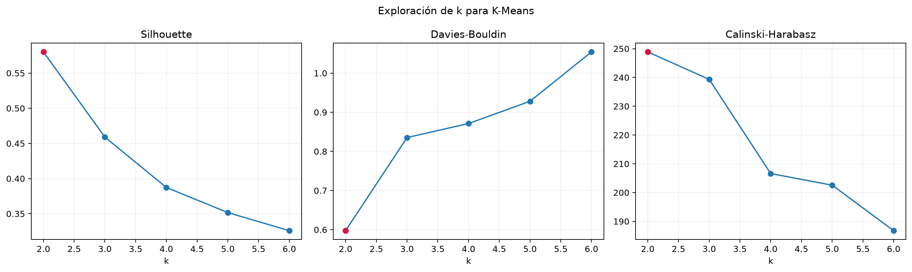

*Figura 1. Comparación de las métricas intrínsecas al variar `k`. El punto rojo
marca el mejor valor de cada métrica según si se busca maximizarla o
minimizarla.*

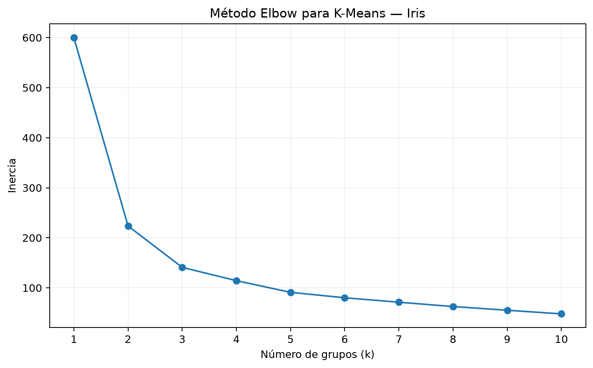

*Figura 2. Inercia de K-Means para distintos valores de `k` en Iris.*

Así que `k=2` sería la opción que se ve mejor desde el punto de vista
geométrico. Para la comparación general se conserva `k=3`, para que todos los
algoritmos trabajen bajo las mismas condiciones y podamos compararlos con las
tres especies originales.

| k | Silhouette | Davies-Bouldin | Calinski-Harabasz | Rand Index | Fowlkes-Mallows |
|--:|-----------:|---------------:|------------------:|-----------:|----------------:|
| 2 | 0.5802 | 0.5976 | 248.90 | 0.7763 | 0.7715 |
| 3 | 0.4590 | 0.8354 | 239.34 | 0.8322 | 0.7452 |
| 4 | 0.3874 | 0.8713 | 206.60 | 0.7763 | 0.6314 |

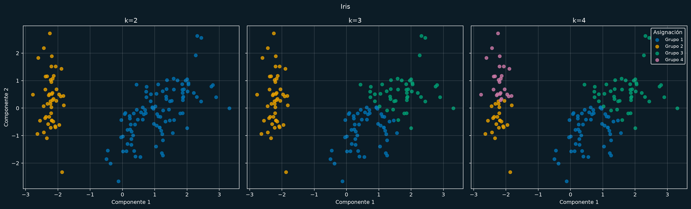

*Figura 3. Comparación de K-Means con `k=2`, `k=3` y `k=4` alrededor del valor
base `k=3`. La proyección PCA es común a los tres paneles; la agrupación se
calculó con las cuatro variables estandarizadas.*

#### IMDb

Se usó `k=2`, `n_init=20` y `random_state=42`. Se compararon `k=2` y `k=7`;
`k=2` obtuvo el mayor Silhouette.

| k | Silhouette | Davies-Bouldin | Calinski-Harabasz |
|--:|-----------:|---------------:|------------------:|
| 2 | 0.2285 | 1.6814 | 298.09 |
| 7 | 0.2037 | 1.3371 | 225.74 |

La comparación de métricas internas y externas se hizo para los mismos dos
valores:

|   k | Silhouette | Davies-Bouldin | Calinski-Harabasz | Rand Index | Fowlkes-Mallows |
| --: | ---------: | -------------: | ----------------: | ---------: | --------------: |
|   2 |     0.2285 |         1.6814 |            298.09 |     0.5085 |          0.3174 |
|   7 |     0.2037 |         1.3371 |            225.74 |     0.7258 |          0.1858 |

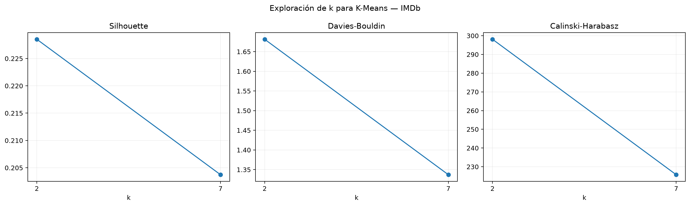

*Figura 8. Métricas intrínsecas para `k=2` y `k=7`. La línea conecta los dos
valores evaluados; los tres indicadores se muestran en paneles separados.*

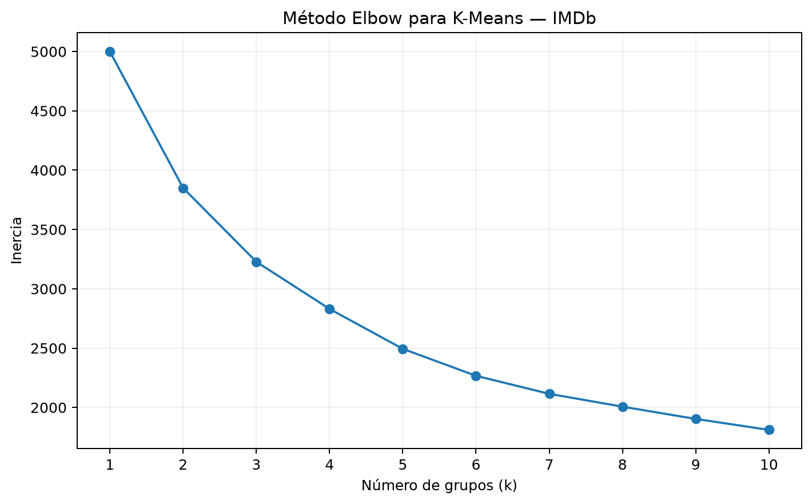

*Figura 9. Inercia de K-Means para distintos valores de `k` en IMDb.*

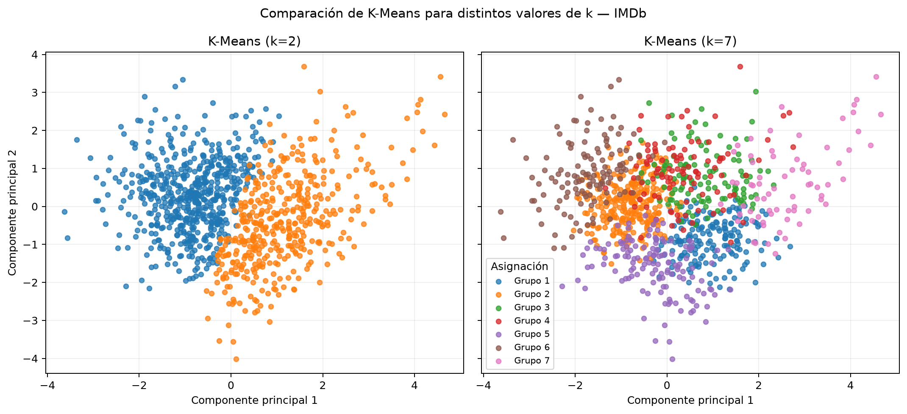

*Figura 10. Comparación de K-Means con `k=2` y `k=7`. La proyección PCA es
común a los dos paneles; la agrupación se calculó con las cinco variables
numéricas preparadas.*

### DBSCAN

#### Iris

DBSCAN busca zonas donde hay muchos puntos juntos. Un punto se considera parte
de una zona densa si tiene suficientes vecinos dentro de un radio determinado.
Los puntos que no pertenecen a ninguna zona se marcan como ruido con la
etiqueta `-1`.

Una ventaja de DBSCAN es que no tenemos que decirle desde el principio cuántos
grupos debe encontrar. También puede encontrar grupos con formas que no sean
redondas.

Se usaron estos parámetros:

- `eps=0.5`: radio para buscar vecinos.
- `min_samples=5`: mínimo de vecinos para considerar que una zona es densa.

Una forma común de escoger estos valores es revisar la distancia al vecino
número `min_samples` y buscar dónde cambia la pendiente de la gráfica. También
hay que considerar cuántos datos tenemos y cuánto ruido esperamos. En este caso
se usó un radio relativamente pequeño para observar la estructura local, por lo
que algunos puntos terminaron como ruido.

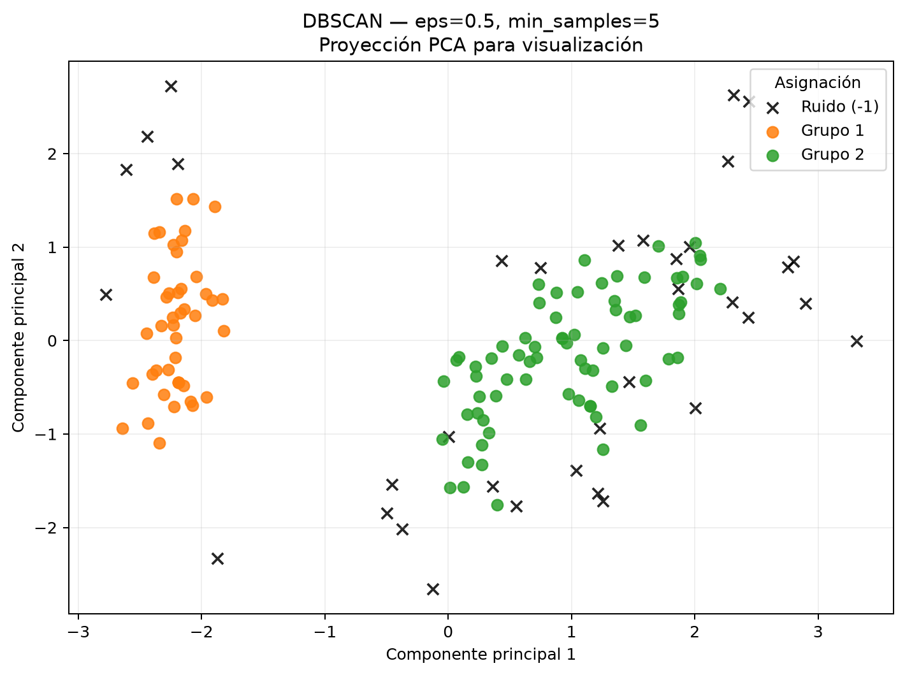

*Figura 4. Resultado de DBSCAN. Las cruces negras representan los 35 puntos
marcados como ruido (`-1`).*

#### IMDb

Se usaron `eps=0.75` y `min_samples=10`. El radio se seleccionó explorando
varios valores y conservando una solución evaluable con el mejor Silhouette,
limitando el ruido a la mitad de las observaciones. Se marcaron 495 películas
como ruido.

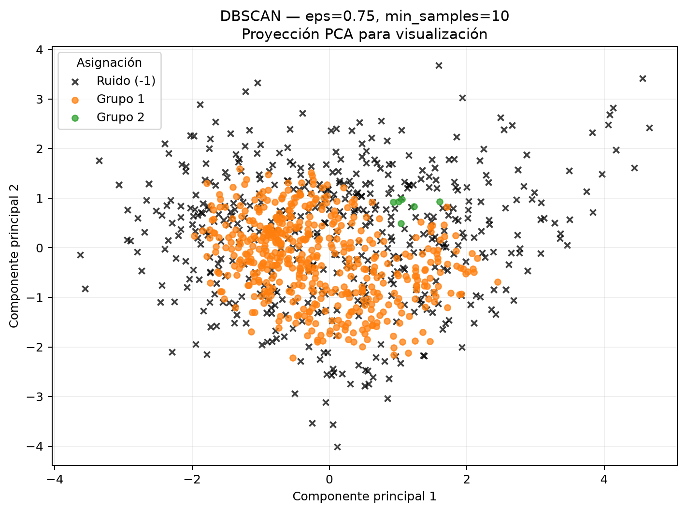

*Figura 11. Resultado de DBSCAN; las cruces negras representan las 495 películas
marcadas como ruido (`-1`).*

### Agglomerative Ward

#### Iris

Este método comienza poniendo cada observación en su propio grupo. Después va
uniendo los grupos que provocan el menor aumento en la variación interna. El
proceso puede verse como un árbol o dendrograma.

Se usó `n_clusters=3` y `linkage='ward'`. Para elegir el número de grupos se
puede revisar el dendrograma o comparar los valores de Silhouette para varios
cortes.

Ward utiliza distancia euclidiana y suele crear grupos compactos. Por eso fue
importante estandarizar las variables antes de aplicarlo.

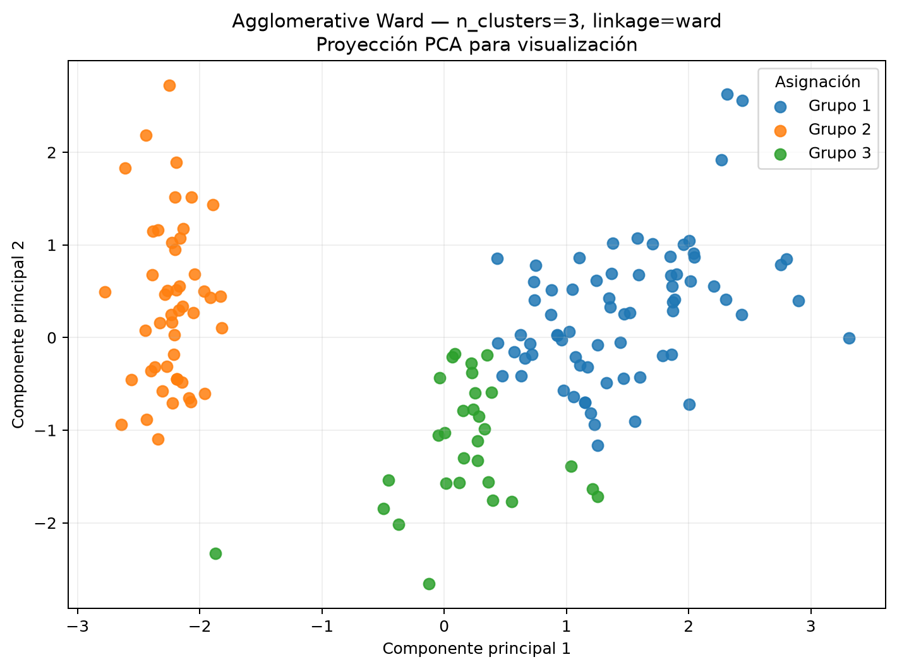

*Figura 5. Resultado de Agglomerative Ward con tres grupos en la proyección
PCA.*

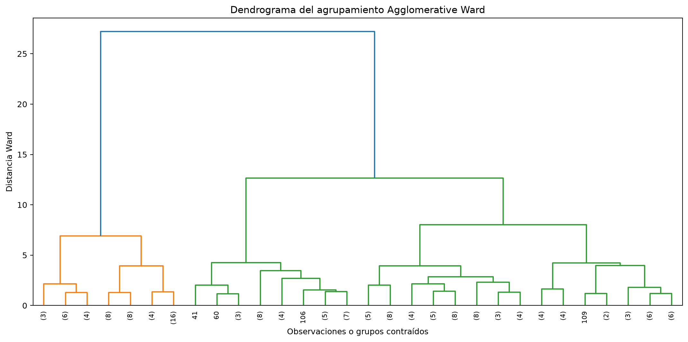

*Figura 6. Dendrograma del proceso jerárquico. Las ramas muestran las
fusiones sucesivas y sus distancias Ward.*

#### IMDb

Se usó `n_clusters=2` y `linkage='ward'` sobre las cinco variables
estandarizadas.

t-sne
umap

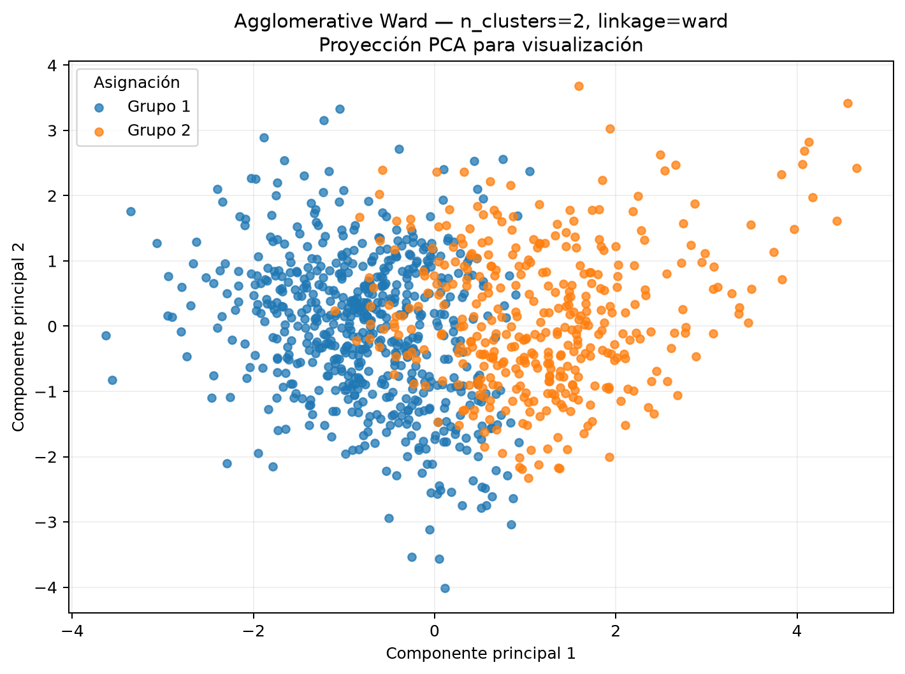

*Figura 12. Resultado de Agglomerative Ward con dos grupos en la proyección
PCA.*

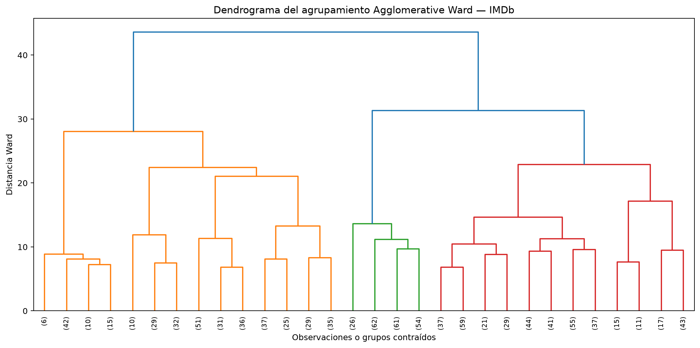

*Figura 13. Dendrograma truncado del proceso jerárquico.*

### CLIQUE

#### Iris

CLIQUE divide cada variable en intervalos y forma unidades o celdas dentro del
espacio de datos. Después cuenta cuántos puntos caen en cada unidad. Las
unidades con suficientes puntos se consideran densas y las unidades densas que
comparten una cara se unen para formar grupos.

Una característica importante de CLIQUE es que puede buscar grupos en
subespacios. En este ejercicio se trabajó con las cuatro variables de Iris y se
usó una cuadrícula de `3` intervalos por dimensión. Por eso, aunque cada
dimensión tiene pocos intervalos, el espacio completo tiene unidades en cuatro
dimensiones.

Los parámetros usados fueron:

- `n_bins=3`: número de intervalos por variable;
- `min_unit_points=5`: mínimo de observaciones para que una unidad sea densa;
- conectividad por caras: no se unen unidades que solo se tocan en una esquina.

Las observaciones que caen en unidades no densas se marcan como ruido (`-1`).
Para elegir los parámetros se debe buscar un equilibrio: pocas divisiones
pueden juntar estructuras diferentes, mientras que demasiadas divisiones dejan
muchas unidades vacías. El umbral de densidad también debe ajustarse al tamaño
del dataset y al ruido esperado.

La implementación del script es una versión sencilla de CLIQUE, suficiente para
mostrar sus pasos principales: discretizar, contar unidades, detectar unidades
densas y unir las unidades vecinas.

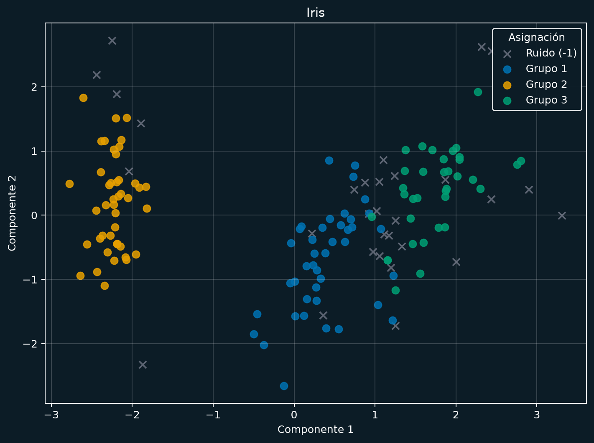

*Figura 7. Resultado de CLIQUE con tres intervalos por dimensión. La técnica
se ejecutó en las cuatro dimensiones; la proyección PCA se muestra únicamente
para poder representar las asignaciones en una imagen.*

#### IMDb

Se trabajó en el subespacio `IMDB_Rating`, `Meta_score`, `log(No_of_Votes)` y
`log(Gross)`, con `n_bins=5` y `min_unit_points=5`. La conectividad entre
unidades densas se definió por caras. El resultado dejó 173 películas como
ruido.

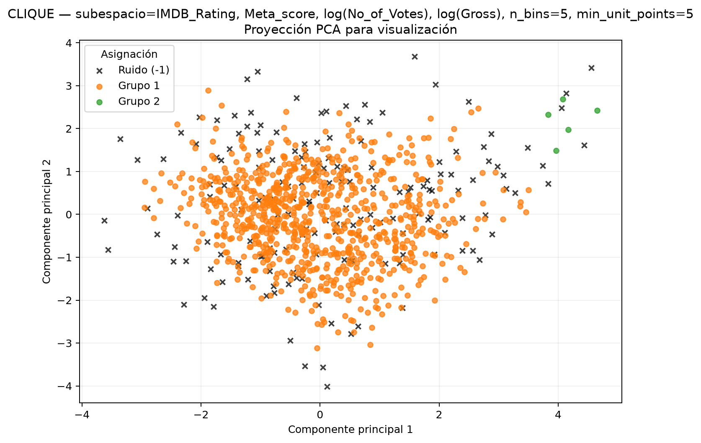

*Figura 14. Resultado de CLIQUE en el subespacio seleccionado; las cruces
negras representan los puntos marcados como ruido (`-1`).*

## Métricas

###  intrínsecas

**Silhouette:** revisa si cada punto está cerca de su propio grupo y lejos de los demás. Va de `-1` a `1`; mientras más alto, mejor.
  
**Davies-Bouldin:** compara qué tan dispersos están los grupos y qué tan separados se encuentran. Mientras más bajo, mejor. El valor ideal sería `0`.

**Calinski-Harabasz:** compara la separación entre grupos con la dispersión dentro de cada grupo. Mientras más alto, mejor.
###  extrínsecas

El **Rand Index** compara pares de objetos: revisa si dos objetos quedaron juntos o separados en el resultado y si eso coincide con el `ground truth`. Su valor va de `0` a `1`; un valor de `1` significa que la coincidencia es perfecta.

También se calculó **Fowlkes-Mallows**, que resume la precisión y el recall de los pares que quedaron en el mismo grupo. En esta métrica, un valor alto también es mejor.

Para DBSCAN, los puntos con etiqueta `-1` sí se incluyeron en las métricas extrínsecas. De esta forma se toma en cuenta que esos objetos quedaron fuera de los grupos.

## Resultados

Usando `random_state=42`, se obtuvieron estos resultados:

| algoritmo          | familia    | grupos | ruido | puntos evaluados | Silhouette | Davies-Bouldin | Calinski-Harabasz | Rand Index | Fowlkes-Mallows |
| ------------------ | ---------- | -----: | ----: | ---------------: | ---------: | -------------: | ----------------: | ---------: | --------------: |
| K-Means            | Partición  |      3 |     0 |              150 |     0.4590 |         0.8354 |            239.34 |     0.8322 |          0.7452 |
| DBSCAN             | Densidad   |      2 |    35 |              115 |     0.6532 |         0.4990 |            332.16 |     0.7415 |          0.6255 |
| Agglomerative Ward | Jerárquica |      3 |     0 |              150 |     0.4455 |         0.8059 |            220.26 |     0.8252 |          0.7498 |
| CLIQUE             | Cuadrícula |      3 |    30 |              120 |     0.4940 |         0.8018 |            229.40 |     0.8666 |          0.7768 |

### IMDb

| algoritmo          | familia    | grupos | ruido | puntos evaluados | Silhouette | Davies-Bouldin | Calinski-Harabasz | Rand Index | Fowlkes-Mallows |
| ------------------ | ---------- | -----: | ----: | ---------------: | ---------: | -------------: | ----------------: | ---------: | --------------: |
| K-Means            | Partición  |      2 |     0 |             1000 |     0.2285 |         1.6814 |            298.09 |     0.5085 |          0.3174 |
| DBSCAN             | Densidad   |      2 |   495 |              505 |     0.0848 |         1.0991 |              7.58 |     0.5060 |          0.2907 |
| Agglomerative Ward | Jerárquica |      2 |     0 |             1000 |     0.1918 |         1.8963 |            233.96 |     0.4938 |          0.3137 |
| CLIQUE             | Cuadrícula |      2 |   173 |              827 |     0.4615 |         0.5396 |             28.81 |     0.3595 |          0.3380 |

## Conclusiones

### iris
- **DBSCAN** tiene los mejores valores intrínsecos sobre los 115 puntos que no
  consideró ruido. Eso significa que sus grupos centrales están bastante bien
  separados y son compactos. El problema es que deja 35 de los 150 puntos como
  ruido y su Rand Index baja a `0.7415`.
- **K-Means** es una opción sencilla, rápida y fácil de explicar. No deja
  puntos como ruido y obtiene un Rand Index alto (`0.8322`).
- **Agglomerative Ward** tiene un resultado parecido a K-Means en Rand Index
  (`0.8252`) y consigue el mejor Davies-Bouldin entre los algoritmos que
  asignan todos los puntos.
- **CLIQUE** obtiene el Rand Index más alto (`0.8666`) y también el mejor
  Fowlkes-Mallows (`0.7768`) en esta comparación. Sin embargo, deja 30 puntos
  como ruido y su resultado depende bastante del número de intervalos y del
  umbral de densidad.

### IMDb

- **CLIQUE** obtiene el mejor Silhouette (`0.4615`) y Davies-Bouldin (`0.5396`)
  entre las soluciones, calculados sobre sus 827 puntos no marcados como ruido.
  Deja 173 películas fuera de los grupos.
- **DBSCAN** identifica dos grupos y marca 495 películas como ruido. Su
  Silhouette es `0.0848` y el Davies-Bouldin es `1.0991`.
- **K-Means** obtiene el Rand Index más alto (`0.5085`), seguido de cerca por
  DBSCAN (`0.5060`). **CLIQUE** obtiene el Fowlkes-Mallows más alto (`0.3380`),
  seguido por K-Means (`0.3174`).
- La elección de `k=2` corresponde al mayor Silhouette (`0.2285`) entre los
  valores evaluados. Además, las métricas externas usan
  solo el primer género de un campo multigénero y la distribución está
  desbalanceada, por lo que describen una referencia aproximada y no una
  etiqueta única original.
