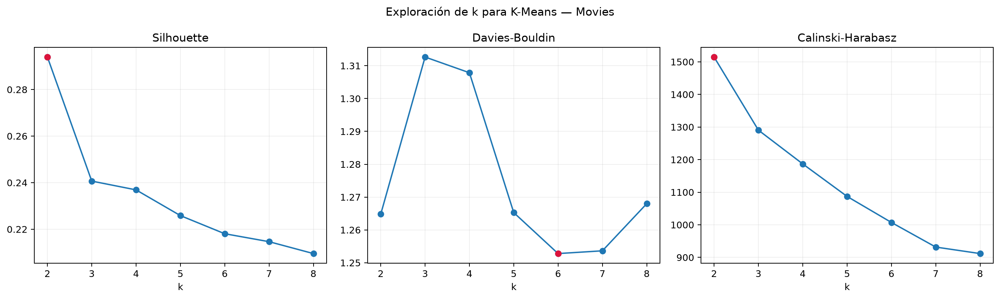
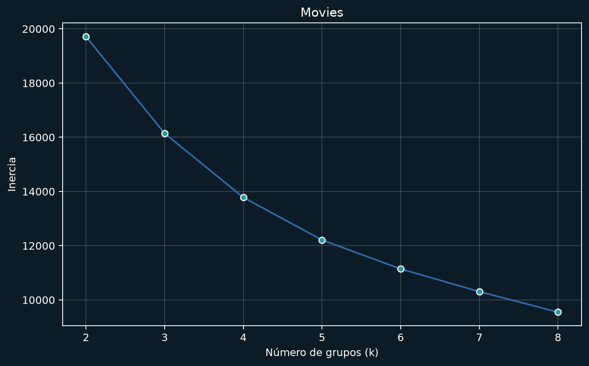
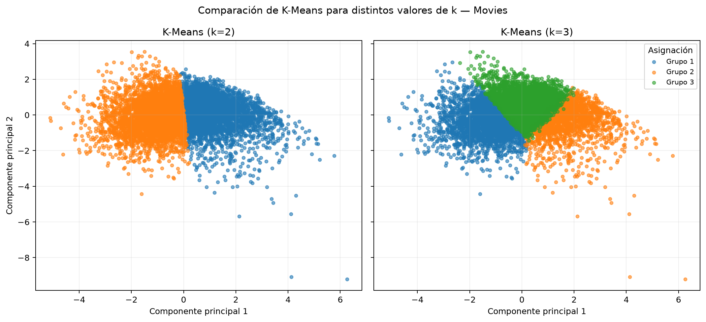
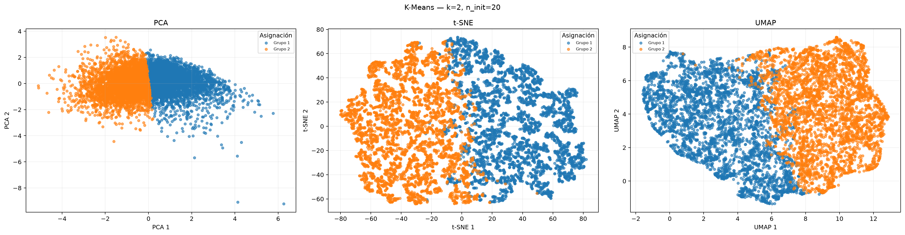
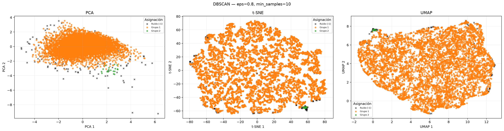
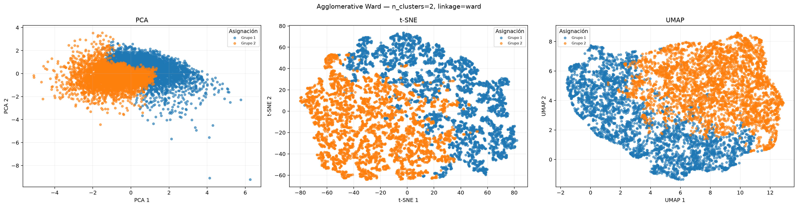
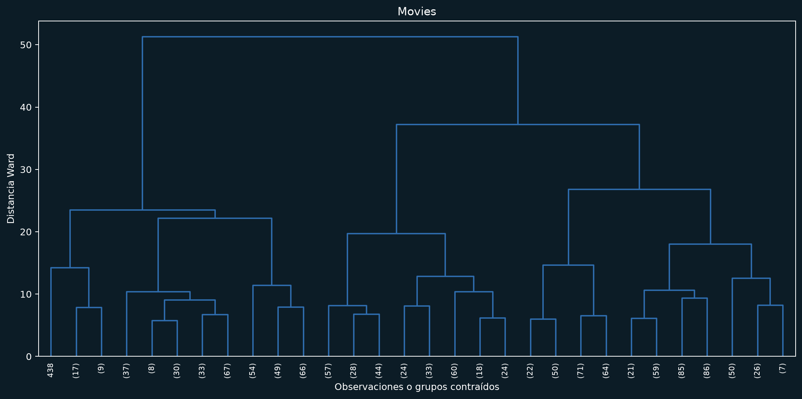
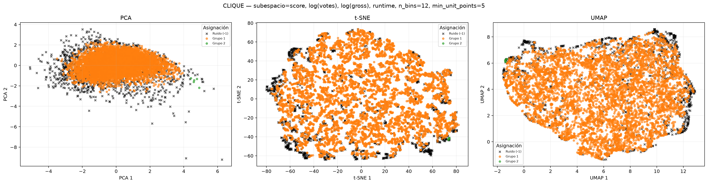

# Análisis de agrupación del dataset Movies

## Objetivo

Aplicar cuatro técnicas de agrupación al dataset `movies.csv`, comparar la
calidad de sus grupos con métricas intrínsecas y contrastar las asignaciones
contra `genre` como `ground truth` mediante métricas extrínsecas. Además, se
comparan PCA, t-SNE y UMAP como proyecciones 2D para visualizar los grupos.

El reporte fue generado automáticamente por [`movies.py`](movies.py). No se
utiliza `genre` durante el entrenamiento de ningún algoritmo.

## Dataset

El archivo contiene **7,412 películas** y 14 columnas. La versión de
entrada ya se encuentra depurada; durante esta ejecución se eliminaron
0 filas adicionales con datos faltantes o valores numéricos
inválidos.

Para evitar que el año de estreno domine las distancias, `year` no se utiliza
como variable de entrada. Las variables empleadas son `score`, `votes`,
`gross` y `runtime`. `votes` y `gross` se transforman con `log1p` porque tienen
una distribución muy asimétrica; después todas las variables se estandarizan.

### Faltantes

| variable | faltantes al cargar |
| --- | --- |
| name | 0 |
| rating | 0 |
| genre | 0 |
| year | 0 |
| released | 0 |
| score | 0 |
| votes | 0 |
| director | 0 |
| writer | 0 |
| star | 0 |
| country | 0 |
| gross | 0 |
| company | 0 |
| runtime | 0 |

No se imputaron datos: las filas incompletas se eliminaron antes de formar la
matriz de entrada.

### Distribución del ground truth

`genre` tiene 18 géneros. Se utiliza como una referencia
externa, no como variable de entrenamiento.

| género | cantidad |
| --- | --- |
| Comedy | 2182 |
| Action | 1666 |
| Drama | 1439 |
| Crime | 536 |
| Biography | 429 |
| Adventure | 419 |
| Animation | 331 |
| Horror | 304 |
| Fantasy | 42 |
| Mystery | 20 |
| Thriller | 12 |
| Family | 10 |
| Romance | 8 |
| Sci-Fi | 8 |
| Western | 3 |
| Music | 1 |
| Sport | 1 |
| Musical | 1 |

## Proyecciones para visualización

Las técnicas de agrupación se ajustan en las cuatro variables estandarizadas;
las proyecciones no participan en el entrenamiento ni en las métricas. Se
generan tres representaciones bidimensionales:

* **PCA:** proyección lineal que conserva la mayor varianza global posible.
* **t-SNE:** preserva principalmente vecindades locales; se usó
  `perplexity=30`, `max_iter=1000` e inicialización
  PCA.
* **UMAP:** conserva estructura local y parte de la estructura global; se usó
  `n_neighbors=15`, `min_dist=0.1` y distancia
  euclidiana.

Las figuras de cada algoritmo contienen tres paneles, uno por proyección. Las
formas de las nubes pueden cambiar entre métodos porque t-SNE y UMAP son
proyecciones no lineales y estocásticas; por ello no sustituyen las métricas
calculadas en el espacio original estandarizado.

## Animaciones del proceso

Se generan GIF reutilizables para presentaciones a partir de una muestra
reproducible de hasta 120 películas en la proyección PCA. Los algoritmos y las
métricas del análisis siguen trabajando con las cuatro variables estandarizadas.
La simulación 2D explica el procedimiento visualmente y no sustituye las
asignaciones finales calculadas en el espacio original.

* [K-Means: reasignación y movimiento de centroides](animaciones/movies-kmeans.gif)
* [DBSCAN: expansión por densidad y ruido](animaciones/movies-dbscan.gif)
* [Agglomerative Ward: fusiones bottom-up](animaciones/movies-agglomerative-ward.gif)
* [CLIQUE: grilla, celdas densas y uniones](animaciones/movies-clique.gif)

## Técnicas utilizadas

### K-Means

K-Means asigna cada observación al centroide más cercano y actualiza los
centroides hasta estabilizar la solución. Se exploraron los valores de
`k=2` a `k=8` usando `n_init=20`; se
seleccionó `k=2` por obtener el mayor Silhouette en la exploración.

| k | Silhouette | Davies-Bouldin | Calinski-Harabasz |
| --- | --- | --- | --- |
| 2 | 0.2940 | 1.2648 | 1514.7600 |
| 3 | 0.2407 | 1.3126 | 1290.3975 |
| 4 | 0.2369 | 1.3079 | 1186.8031 |
| 5 | 0.2258 | 1.2653 | 1087.0713 |
| 6 | 0.2181 | 1.2528 | 1007.1957 |
| 7 | 0.2147 | 1.2536 | 931.6714 |
| 8 | 0.2095 | 1.2680 | 911.7106 |

*Figura 1. Métricas intrínsecas al variar `k`; el punto rojo marca el mejor
valor de cada métrica.*

*Figura 2. Inercia de K-Means para los valores explorados.*

La comparación detallada de los valores seleccionados quedó así:

| k | Silhouette | Davies-Bouldin | Calinski-Harabasz | Rand Index | Fowlkes-Mallows |
| --- | --- | --- | --- | --- | --- |
| 2 | 0.2940 | 1.2648 | 1514.7600 | 0.5090 | 0.3230 |
| 3 | 0.2407 | 1.3126 | 1290.3975 | 0.6048 | 0.2847 |

*Figura 3. Proyección PCA común para comparar las asignaciones de K-Means.*

*Figura 4. Asignaciones finales de K-Means observadas en las tres
proyecciones.*

### DBSCAN

DBSCAN identifica regiones densas a partir de un radio `eps` y un mínimo de
vecinos. Las observaciones que no pertenecen a una región densa se marcan
como ruido (`-1`). Se probaron los radios configurados en el script y se
conservó la solución válida con mejor Silhouette, sin permitir que el ruido
superara la mitad del dataset.

Parámetros seleccionados: **eps=0.8, min_samples=10**.

*Figura 5. Resultado de DBSCAN en las tres proyecciones; las cruces negras
representan el ruido.*

### Agglomerative Ward

El método jerárquico comienza con una observación por grupo y va uniendo los
grupos que producen el menor aumento de variación interna. Se utilizó Ward
con distancia euclidiana y el mismo `k=2` seleccionado para
K-Means. El dendrograma se generó con una muestra reproducible de hasta
1200 películas para mantener la figura legible.

Parámetros: **n_clusters=2, linkage=ward**.

*Figura 6. Resultado de Agglomerative Ward en las tres proyecciones.*

*Figura 7. Dendrograma truncado sobre una muestra reproducible.*

### CLIQUE

CLIQUE divide cada variable en intervalos, cuenta las observaciones de cada
celda y conecta las celdas densas que comparten una cara. Las observaciones
que caen en celdas no densas se marcan como ruido. Se exploraron varios
subespacios, números de intervalos y umbrales, conservando la solución válida
con mayor Silhouette.

Parámetros seleccionados: **subespacio=score, log(votes), log(gross), runtime, n_bins=12, min_unit_points=5**.

*Figura 8. Resultado de CLIQUE en las tres proyecciones; las cruces negras
representan el ruido.*

## Métricas

Las métricas intrínsecas se calcularon sobre las observaciones no marcadas
como ruido:

* **Silhouette:** valores altos indican que las observaciones están cerca de su
  propio grupo y lejos de los demás.
* **Davies-Bouldin:** valores bajos indican grupos compactos y separados.
* **Calinski-Harabasz:** valores altos indican mayor separación entre grupos
  frente a la dispersión interna.

Rand Index y Fowlkes-Mallows son métricas extrínsecas: comparan las
asignaciones contra `genre`. En estas dos métricas sí se incluyen las
observaciones marcadas como ruido, tratándolas como la etiqueta `-1`.

Para que el cálculo sea reproducible y manejable en este dataset, las métricas
de distancia usan una muestra aleatoria fija de hasta 3000
observaciones cuando hay más datos; Rand Index y Fowlkes-Mallows se calculan
con todos los registros.

## Resultados

Se utilizó `random_state=42` cuando el algoritmo lo permite.

| algoritmo | familia | grupos | ruido | puntos evaluados | Silhouette | Davies-Bouldin | Calinski-Harabasz | Rand Index | Fowlkes-Mallows |
| --- | --- | --- | --- | --- | --- | --- | --- | --- | --- |
| K-Means | Partición | 2 | 0 | 7412 | 0.2940 | 1.2648 | 1514.7600 | 0.5090 | 0.3230 |
| DBSCAN | Densidad | 2 | 126 | 7286 | 0.4608 | 0.5070 | 26.8423 | 0.2146 | 0.4284 |
| Agglomerative Ward | Jerárquica | 2 | 0 | 7412 | 0.2359 | 1.4796 | 1101.4165 | 0.5120 | 0.3288 |
| CLIQUE | Cuadrícula | 2 | 1303 | 6109 | 0.5588 | 0.3959 | 27.6647 | 0.3767 | 0.3757 |

## Conclusiones

* **Mejor Silhouette:** CLIQUE con
  `0.5588`. Sus grupos son los más compactos y
  separados bajo esta métrica, considerando únicamente los puntos sin ruido.
* **Mejor Davies-Bouldin:** CLIQUE con
  `0.3959`; un valor menor es mejor.
* **Mejor Calinski-Harabasz:** K-Means con
  `1514.76`.
* **Mejor Rand Index:** Agglomerative Ward con
  `0.5120`.
* **Mejor Fowlkes-Mallows:** DBSCAN con
  `0.4284`.

Las métricas extrínsecas deben interpretarse con cuidado: `genre` es una
categoría editorial, tiene una distribución desbalanceada y no necesariamente
representa la geometría numérica formada por calificación, popularidad,
recaudación y duración. Por eso, la elección final del algoritmo debe
considerar simultáneamente la calidad geométrica, la cantidad de ruido y el
objetivo del análisis.
